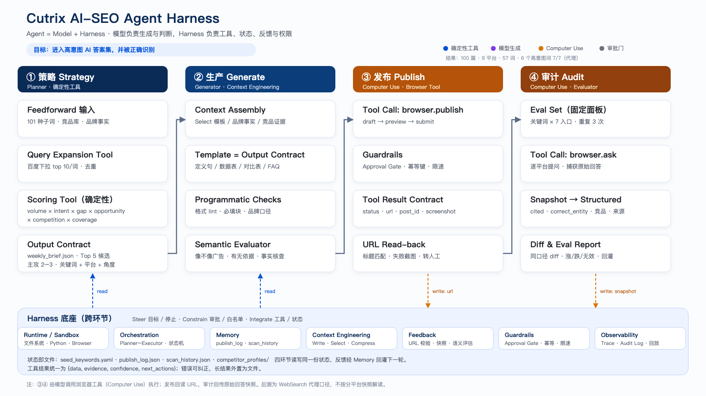

> 7 周 · 100 篇内容 · 9 个平台 · 57 个关键词 · 一个人 + 自建Agent

## 0. 一句话描述价值

做什么：把 AI-SEO 从「多发文章」改造成一个 Agent 闭环：**确定性工具选词，模型写内容，浏览器工具发布和复测，反馈回灌下一轮。** 形成标准化Agent工具，换一个市场、一种语言、一个平台，不用从零开始猜

## 1. 背景：AI 答案成了新的货架

Cutrix 是 AI 视频翻译与配音产品，覆盖 50+ 语言，人力经费有限。

目标用户越来越多直接问 AI「有什么好用的视频翻译工具」——AI 的回答就是新的货架。我们没有投放预算，能做的只有让内容进入答案集。

难的不是写文章，而是三个问题：

- 哪些词值得写？
- 写完发到哪里？
- 发完有没有用？

这三个问题，正好对应一套 Agent 系统要解决的：**策略、执行、反馈**。

## 2. 系统：四段闭环

| 环节 | 做什么 | Harness 设计 |
|---|---|---|
| ① 策略 | 101 个种子词扩展、去重、打分 | 确定性打分，输出 Top 候选 |
| ② 生产 | 按模板生成结构化长文 | 模板 = 输出契约；程序检查 + 语义评估 |
| ③ 发布 | 浏览器发布到 9 个平台 | Computer Use；审批门、URL 回读 |
| ④ 审计 | 固定面板提问、快照回传 | `browser.ask`；同口径 diff，结果回灌 |

模型负责生成与判断，Harness 负责工具、状态、反馈和权限。四个环节读写同一份状态，审计结果反哺下一轮策略。

## 3. 过程：三次关键策略调整

**第一次：从宽泛词转向高意图词。**
第一周按打分器推荐打了 5 个宽泛词、16 篇，很快发现：宽泛词的答案集是「通用指南 / 平台名单」，新品牌很难挤进去。第二周转向「XX 对比」「价格」「API」这类决策词——query 本身就在点名工具或报价，一篇 exact-match 的内容就能进入答案。6 个非品牌高意图词做到 7 个入口全覆盖，其中 3 个是从 0 起。

**第二次：从「写给人看」到「写给答案抽」。**
AI 不爱读长文，爱抽定义、清单、对比表。我们把定义句、对比表、FAQ、数据表前置，每一块都能独立被摘走。

**第三次：从「发完就完」到「固定面板复测」。**
同一批词、同一批入口、同一套问题，前后各问一遍。这样看的不是单篇阅读量，而是「这个词的答案里有没有我们」。

## 4. 结果收益

- **7 周 100 篇，9 个平台、57 个关键词**，一个人 + 自建Agent。
- **品牌词提及率 60% → 100%**：搜「Cutrix」的答案，一定会提到 Cutrix。
- **非品牌词提及率 14% → 22%**：高意图词开始进入答案集；对比 / 价格 / API 这组词全部做到 7/7(AI平台)，其中 3 个从 0 起。

## 5. 复盘：做对了什么，如果提前做什么会更好，还可以做什么优化

| 做对了什么 | 没做好的地方 | 还可以继续优化的方向 |
|---|---|---|
| 把选词、生产、发布、审计拆成可验证的工具调用，而不是一次性写稿 | 选词时把「答案形态」变成显式字段：这个 query 的答案是工具清单、报价表还是 how-to | 可以把行业热点新闻抓取、抽样洗稿，作为关键词库和内容补充 |
| 用固定面板 + 同口径 diff 做反馈，而不是看单篇阅读量 | 评测先行：第一天就固定面板和分平台快照，代理数据只用于看方向 | 不止看有没有出现，还可以把出现的内容形式进行分析和模式识别，用于指导后续的内容生产模版skill优化 |
| 先小成本试错，再把有效角度放大 | 设止损线：一个词 3–5 篇仍无出现就换角度；留一组不写的词做对照 | 可以设置trigger，形成自主执行的loop |
